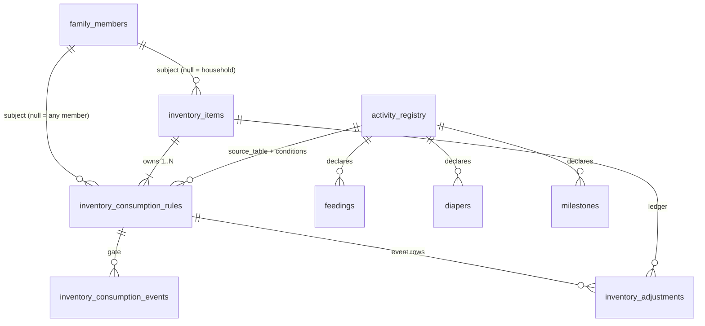

# Inventory Consumption Rules — Design

How a logged event becomes stock consumed: *"subtract X from this item for
every N units of logged activity Y"* — 1 dishwasher tablet per 4 bottle feeds,
3 wipes per diaper change, 1 filter per season.

**Status.** Phase 1 (the shipped journey) lives in PR #42 / issue #40. This
document records what shipped, why it stops scaling, and the target model for
Phase 2 — the tables, their relationships, and the migration path between them.
The Phase 3 sketch below (a normalized `activity_events` shadow table) is
superseded by `event-model-design.md`, which removes the shared-table
workaround instead of copying it.

---

## 1. The journey it serves

You set up *Dishwasher tablets, 60 in the tub*, and link it to **Feed → only
bottle feeds → every 4, subtract 1**. The first three bottle feeds change
nothing — the progress carries on the rule — and the fourth takes one tablet
off and writes a single `used` row in the ledger. A tub of wipes still comes
down by 3 per diaper change, and an item with no link is untouched.

## 2. What shipped (Phase 1)

Rule fields on `inventory_items`:

| Column | Meaning |
| --- | --- |
| `event_category` | The table whose events bill this item (`'feedings'`, `'diapers'`) |
| `event_option` | Equality filter against one route-chosen column (`'bottle'`), or NULL = any |
| `units_per_decrement` | N — units of activity per whole use (NULL = 1) |
| `decrement_per_event` | X — subtracted per whole use (NULL = 1) |
| `consume_carry` | Sub-unit progress accrued between logs |

Plus two supporting tables:

- **`inventory_consumption_events`** — the idempotency gate, `UNIQUE (item_id,
  ref_table, ref_id)`. Needed because a sub-unit event writes no ledger row, so
  the ledger's own unique index can't gate a retry that only accrues carry.
- **`inventory_adjustments`** — the ledger. Whole uses only; `UNIQUE (item_id,
  ref_table, ref_id)` still protects event-sourced rows written before the gate
  existed.

One shared helper, `applyEventConsumption()` (`api/src/inventory-consume.ts`),
is called by the diaper route, the feeding route, and `POST /inventory/consume`.
The arithmetic — carry, `floor(carry / N)`, ledger-on-whole-use — is correct for
any source and does not change in this design.

## 3. Why Phase 1 stops scaling

1. **Two registries, one hand-kept.** The picker is served by
   `GET /inventory/activities`, which filters a hard-coded `WIRED_TABLES` list.
   A new log type needs a route call *and* a whitelist edit; miss one and the
   honest picker silently shrinks again. The `'dry'`-option fix in PR #42 was an
   early symptom: the same activity was described in two places and had drifted.
2. **One scalar filter.** `event_option` is equality against one column. It
   cannot express milestones' shared table (routine *bath* vs first *bath*),
   value sets, or numeric predicates ("feeds over 60 ml"). The reminders system
   already hit this wall and solved it with condition lists; inventory is
   re-learning the lesson.
3. **Units are fixed at 1.** The gate stores a `units` column but every route
   passes 1 — an activity log that carries its own count ("washed 8 bottles")
   has nowhere to speak from.
4. **The rule lives on the item.** `consume_carry` and the gate's
   `(item_id, …)` key assume exactly one rule per item. A second rule, or one
   rule shared across items, collides immediately.
5. **Matching is subject-only.** `subject_id = ?` means household items
   (detergent, tablets) bill only from *one child's* feeds. A second baby's
   bottles never decrement them; there is no "any member" scope.

## 4. Target model

Three moves: **one registry, one funnel, one rule document.**

### 4.1 One activity registry (code, not a table)

Merge `WIRED_TABLES` into the `SOURCES`-style registry so every log source
declares itself once:

```ts
feed: {
  table: 'feedings', label: 'Feed', time: 'start_time', consumable: true,
  attributes: [
    { key: 'type',   column: 'type',   kind: 'enum',
      values: ['breast', 'bottle', 'pump', 'formula', 'solid'] },
    { key: 'amount', column: 'amount', kind: 'number' },  // declared; unused until a journey needs it
  ],
},
milestones: {
  table: 'milestones', label: 'Milestone', consumable: true,
  attributes: [
    { key: 'kind',     column: 'kind',     kind: 'enum', values: ['routine', 'first', 'medical', 'safety'] },
    { key: 'category', column: 'category', kind: 'enum', values: [ /* per-kind lists */ ] },
  ],
},
```

Both `GET /reminders/catalog` and `GET /inventory/activities` project from it,
rule conditions are validated against it (attribute exists? value known?
family-custom options merged, as reminders already do), and `WIRED_TABLES`
ceases to exist as a concept.

### 4.2 One funnel

Routes emit instead of calling the inventory helper:

```ts
emitActivity(db, {
  source: 'feedings', refId, subjectId, time,
  attrs: { type: 'bottle' },   // the registry says which columns those map to
  units: 1,                    // batch logs may pass more
})
```

`emitActivity` loads the registry entry, finds candidate rules, evaluates their
conditions against `attrs`, and runs the unchanged carry/gate/ledger math.
The picker's honesty guarantee is enforced mechanically by a **conformance
test**: for every registry entry with `consumable: true`, POST a record through
its route and assert the event billed. A forgotten route fails CI instead of
quietly absenting an option from the picker.

> *Alternative considered:* `AFTER INSERT` SQLite triggers writing a normalized
> `activity_events` log, so routes never know inventory exists. Stronger than
> a test — but moves logic into schema, and the per-route emit is one uniform
> line either way. Revisit only if the conformance test becomes a burden.

### 4.3 The rule document

```sql
CREATE TABLE inventory_consumption_rules (
    id             INTEGER PRIMARY KEY AUTOINCREMENT,
    item_id        INTEGER NOT NULL REFERENCES inventory_items(id) ON DELETE CASCADE,
    source_table   TEXT NOT NULL,              -- key into the activity registry
    subject_id     INTEGER,                    -- NULL = any member's events (household items)
    match          TEXT NOT NULL DEFAULT 'all',      -- 'all' | 'any'
    conditions     TEXT,                       -- JSON: [{ attr, values: [...] }]
    units_per_use  INTEGER NOT NULL DEFAULT 1,       -- N
    amount_per_use REAL NOT NULL DEFAULT 1,          -- X
    consume_carry  REAL NOT NULL DEFAULT 0,          -- moved from inventory_items
    active         INTEGER NOT NULL DEFAULT 1,
    created_at     TEXT NOT NULL,
    updated_at     TEXT NOT NULL
);

CREATE TABLE inventory_consumption_events (
    id         INTEGER PRIMARY KEY AUTOINCREMENT,
    rule_id    INTEGER NOT NULL REFERENCES inventory_consumption_rules(id) ON DELETE CASCADE,
    ref_table  TEXT NOT NULL,
    ref_id     INTEGER NOT NULL,
    units      REAL NOT NULL DEFAULT 1,
    created_at TEXT NOT NULL,
    UNIQUE (rule_id, ref_table, ref_id)        -- re-keyed from (item_id, …)
);
```

Carry and the gate move *to the rule* — they describe progress of a rule, not
of an item. `inventory_adjustments` gains a nullable `rule_id`: event-sourced
rows carry it (and the unique index becomes partial,
`UNIQUE (rule_id, ref_table, ref_id) WHERE rule_id IS NOT NULL`); manual and
scheduled rows keep `rule_id NULL`. The ledger stays keyed by `item_id` for
forecasts, rates, and drift — those are per-item questions.

The formula journey (issue #81) extended the same document rather than
inventing a second mechanism: `amount_attr`, nullable, says the bill is the
event's own number for the named attribute — a feed's `amountOz` — instead of
the X-per-N ratio. One ledger row per event, fractional amounts intact; the
carry arithmetic does not apply. A rule with `amount_attr` is **pinned to its
container**: `emitActivity` receives `billedItem` (the feed's
`formula_item_id`) and applies the rule only when the event names it — so two
open cans each burn only their own stock, and an event that names no can
bills nothing ("we don't know which can you fed" beats every can draining at
once). Whole-use rules keep matching any member's events regardless; the pin
is a fact about distribution, not about matching.

### 4.4 Conditions

```jsonc
{ "match": "all",
  "conditions": [ { "attr": "type", "values": ["bottle"] } ] }
```

- *Match semantics:* with `match: 'all'` (the default) **every** condition must
  hold for **the same event** — it is a filter on one record, not an
  inactivity test across time (that remains reminders' job).
- Conditions are attribute-level, not column-level: the registry maps
  `attr → column`, so nothing outside the registry names SQL.
- The shape reserves an optional `range: [lo, hi]` for `kind: 'number'`
  attributes; the evaluator ships enum-only until a journey asks.

Worked examples:

| Journey | Conditions | match |
| --- | --- | --- |
| 3 wipes per change | `[{ attr: 'type', values: ['wet','dirty','both','dry'] }]` (or no conditions = any) | all |
| 1 tablet per 4 bottle feeds | `[{ attr: 'type', values: ['bottle'] }]` | all |
| 1 per 10 *routine* baths | `[{ attr: 'kind', values: ['routine'] }, { attr: 'category', values: ['bath'] }]` | all |

The second and third lines are what the Phase 1 scalar cannot say — the
milestones ambiguity (one table, two kinds) resolves as two conditions instead
of a `kind:category` string hack.

### 4.5 Matching and billing, end to end

1. A route inserts the record (unchanged) and calls `emitActivity` with its
   source, ids, subject, and attribute values.
2. Candidate rules: `active = 1 AND source_table = source AND (subject_id =
   subjectId OR subject_id IS NULL)`.
3. Per rule: conditions evaluated against `attrs`; no match → skip.
4. Idempotency: insert the gate row (`UNIQUE (rule_id, ref, ref)`) — a hit
   means already applied. For rows written before Phase 2, a ledger row with
   the same `(item_id, ref_table, ref_id)` and `rule_id` backfilled reads as
   "already applied", exactly as Phase 1 handles pre-gate diaper rows.
5. `carry += units`; `whole = floor(carry / N)`; if `whole > 0`, write one
   ledger row of `−whole × X`, subtract it from `quantity`, `carry −= whole × N`.
   Otherwise only `carry` updates.
6. Route behavior is unchanged: the record is already stored, so a consumption
   failure warns and never fails the request.

### 4.6 What deliberately does not change

Remainder-carry, whole-uses-only ledger, gate-before-apply idempotency, the
`quantity` clamp at zero, forecasts/drift/alerts, and the synchronous
bill-at-log-time timing. The arithmetic in `applyEventConsumption` survives as
the evaluator's core; only its *input* generalizes.

## 5. Tables and relationships



- **`activity_registry` is code, not SQL** (`api/src/reminder-conditions.ts`
  extended per §4.1); it is drawn to show where `source_table` and every
  `conditions[].attr` get their vocabulary.
- **One item owns 1..N rules** — Phase 1's four columns project to exactly one
  rule row, so nothing changes for existing data; the schema simply stops
  assuming it.
- **Both `inventory_items` and `inventory_consumption_rules` point at
  `family_members`**, and both subject columns accept NULL: items are
  household-scope, rules with `subject_id NULL` follow *any* member's events —
  the fix for the second-child limitation (§3.5).
- **Two writers reach `inventory_adjustments`**: rules (event rows, `rule_id`
  set) and humans/the scheduler (manual purchase, scheduled consumption,
  `rule_id NULL`). The gate table is the *only* idempotency authority for
  events; the ledger's old `(item_id, ref, ref)` unique index becomes the
  partial rule-scoped one.

## 6. From Phase 1 columns to rules rows

One migration, per item that has a link:

| Phase 1 column | Rules row |
| --- | --- |
| `event_category = 'feedings'` | `source_table = 'feedings'` |
| `event_option = 'bottle'` | `conditions = [{ attr: 'type', values: ['bottle'] }]` |
| `event_option IS NULL` | `conditions = NULL` (any) |
| `units_per_decrement = 4` | `units_per_use = 4` |
| `decrement_per_event = 1` | `amount_per_use = 1` |
| `subject_id` | `subject_id` (unchanged) |
| `consume_carry = 3` | `consume_carry = 3` |
| — | `match = 'all'` (new default) |

Gate rows move `item_id → rule_id` (safe: every Phase 1 item has at most one
linked rule). Event-sourced ledger rows get `rule_id` backfilled where the
item had a link. Unlinked items produce no rule row.

**API compatibility:** `GET /inventory` keeps returning the flattened shape
(plus a nested `consumptionRule`), and create/update accept either form — the
same dual-read precedent reminders set when `category` grew into `conditions`.
The four legacy columns are deprecated on write, dropped one release later.

## 7. UI

The picker does not become a query builder:

- One consumable enum attribute (feeds, diapers, sleep…) → today's exact
  controls: *Which log → Only those that are → Every N, subtract X*.
- Two (milestones) → the same row plus one more select under *"when all of
  these match"*.
- The activity list stays `GET /inventory/activities` — now the registry's
  `consumable` entries, so it cannot drift from what fires.
- Cards/table keep showing the rule in words (*"uses 1 per 4 bottle feeds"*),
  rendered from `units_per_use` / `amount_per_use`.

## 8. Phasing

| Phase | Contents | Status |
| --- | --- | --- |
| **1** | Helper + gate table + rule columns on the item; feeds and diapers wired; picker guarded by `WIRED_TABLES` | **Shipped — PR #42** |
| **2** | Registry merge, `inventory_consumption_rules`, conditions, per-rule carry/gate, `subject_id NULL` scope, conformance test, migration §6 | **Implemented in this PR** |
| **3 (optional)** | Trigger-based emission / normalized `activity_events`; numeric `range` conditions; batch `units` from log forms | Deferred |

Phase 1's columns are trivially projectable (§6), so landing PR #42 first
commits nothing — the model change is a forward migration, not a rework.

## 9. Non-goals

- Multiple rules per item *in the UI* — the schema absorbs them; no journey
  needs them yet.
- Numeric operators — shape reserved (`range`), evaluator enum-only.
- Cross-item or derived rules ("everything in this category comes down per
  change").
- Async or scheduled billing — consumption stays synchronous at log time.
- A separate registry for reminders — this design merges the two vocabularies,
  it does not fork them.

## 10. Open questions

- **Edits and deletes don't rebill**, for any activity — a feed logged as
  breast, then edited to bottle, never bills a bottle-linked rule, and deleting
  a feed never restores stock. True in Phase 1 too. Revisit when offline-queue
  edits make record mutation common; a `ref`-keyed reversal row is the likely
  shape (the gate already identifies the event).
- **Batch units** — `emitActivity` accepts `units`; no log form emits a count
  yet ("washed 8 bottles" needs a home for that number in the form).
- **Alert vocabulary** — `inventory_rules` (low-stock alerts) name item columns
  and signals rather than registry sources; likely to share labels from the
  same registry eventually, but nothing forces it in Phase 2.
